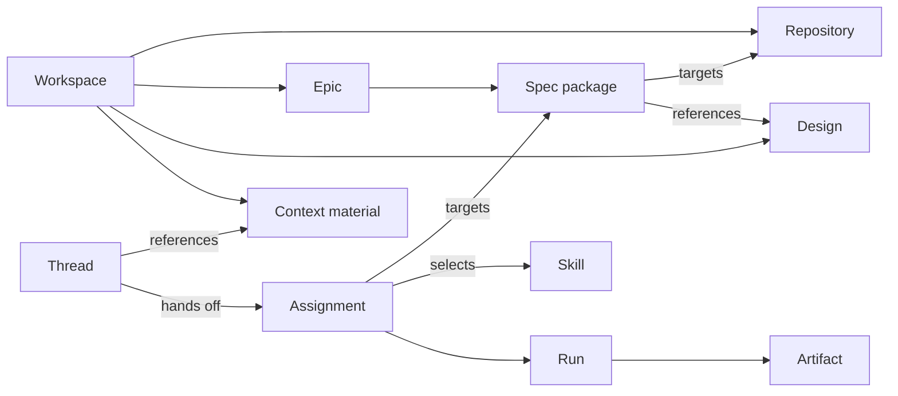
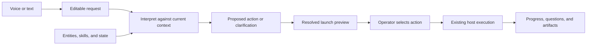

# Contextual command surface for AI coding

Status: product vision. This document describes proposed behavior, not shipped capabilities.
The [proof of concept](contextual-command-surface-ai-coding-poc.md) defines the first viability experiment.

## The experience

An operator opens Sentinel on a phone, describes an outcome aloud, and receives a short proposed action.
Sentinel uses the current page, workspace records, and work history to interpret the request.
The operator selects the action, and the execution host carries out the appropriate skill.
The operator can leave the app and return to the task, its progress, questions, and results.

For example:

- “Split this onboarding work into packages” becomes “Plan an epic for customer onboarding.”
- “Produce the screens we planned” becomes “Build the onboarding design package.”
- “Implement this” on a prepared spec becomes “Implement the customer onboarding spec.”

Each proposal names the workspace and entity. It explains the intended outcome and the relevant inputs.
The app offers a second or third interpretation only when those alternatives represent different plausible requests.
The operator can correct the transcript, change the target, or continue the discussion.

Voice and text enter the same interpretation path. Voice removes typing, while contextual interpretation removes repeated explanation.

## A connected model of the work

Sentinel needs a queryable model of entities, relationships, available actions, and recorded state.
The existing workspace files remain authoritative. A derived index can provide graph queries without a graph database.

This diagram describes desired relationships. It does not claim that every relationship already has a machine-readable record.
Assignments can also target workspaces, repositories, designs, or epics.

| Entity | Relevant facts and relationships |
| --- | --- |
| Workspace | Name, aliases, repositories, execution host, shared context, and related work |
| Repository | Role, checkout identity, branch, and available search capability |
| Design | Brief, screen plan, produced screens, captures, and related specs |
| Epic | Goal, member specs, dependencies, and planning artifacts |
| Spec package | Scope, target repositories, preparation records, steps, reviews, and linked designs |
| Skill | Purpose, accepted target types, prerequisites, inputs, outputs, and effects |
| Context material | Title, source, entity associations, and availability |
| Thread and assignment | Request, chosen action, launch contract, and native session association |
| Run and artifact | Observed activity, outcome, evidence, and resulting files or links |

Entity identity must remain separate from display names and host paths.
The existing resolver owns package paths and execution-host constraints.
Every indexed fact needs a source and observation time. Missing or unreadable records remain unknown.

Work state has several dimensions. Preparation readiness, execution history, current activity, review outcome, and publication state need separate facts.
A prepared spec can have earlier failed attempts. An idle process does not establish that implementation is complete.
File presence alone does not establish acceptance.

## Context changes interpretation

The client sends the current workspace, entity, thread, and explicitly attached material with each request.
Sentinel uses these references to form a bounded context packet.

| Current surface | Default interpretation scope |
| --- | --- |
| Sentinel home | Known workspaces, explicit names, and relevant recent work |
| Workspace | Its repositories, context material, designs, epics, and specs |
| Design package | Its brief, screen plan, and production state |
| Epic | Its goal, member packages, and dependencies |
| Spec package | Its scope, preparation state, history, and current assignment |
| Active assignment | Its status and available interaction controls |

An explicit reference to another workspace overrides the page default after identity resolution.
Recent activity provides a hint, not proof of the intended target.
“Implement this” on an active spec needs a different proposal from the same words on an unstarted spec.
Sentinel can propose opening the active assignment rather than starting duplicate work.

Ambiguous file references remain visible. “Use the notes from yesterday” needs identifiable material or a focused question.
The app must not silently attach an arbitrary file with a similar title.

## From request to proposed action

The proposed action contains:

- The intended outcome, workspace identity, entity identity, and selected skill, if any.
- Resolved context references and unresolved allusions.
- Relevant prerequisites and recorded state.
- A proposed approach to web research and repository search.
- Any question that prevents a useful assignment.

The interpreter receives candidate identities from the catalog. It cannot create authority through invented paths, commands, or entity names.
Ordinary code checks target membership, prerequisite evidence, current activity, and execution-host availability.
The skill remains responsible for its detailed preflight and workflow.

A request can remain a conversation. General questions and incomplete ideas do not require a skill assignment.

## Model responsibilities

A fast generative model can extract goals, constraints, references, and possible actions from the transcript.
A fast DeepSeek model is the candidate for evaluation, not a fixed requirement.
Sentinel already uses `deepseek/deepseek-flash` for [thread titles](../scripts/workspaces/naming.mjs).
That existing use does not establish its accuracy for contextual interpretation.

Jev can assess bounded questions against supplied state or select among known candidates.
Its interface provides choices, scores, and proposition probabilities. It does not generate the proposed explanation.
[TypeSafe documents these primitives](https://docs.typesafe.ai/introduction).

One possible division assigns extraction to a generative model and candidate assessment to Jev.
A simpler baseline uses one generative model plus deterministic checks.
Measured accuracy and latency determine whether the additional model call improves the experience.
Model confidence does not establish correctness or permission to start work.

Independent questions can share a request. Dependent decisions require resolved inputs before the next decision.
For example, entity selection must agree with the selected workspace.

## Research and repository search

The action can distinguish explicit research requests from suggested research.
Web research is relevant to current external facts, unfamiliar technologies, or evidence that the operator requests.
Repository search is relevant to locating behavior, understanding dependencies, or interpreting source references.

Catalog lookup and targeted context reads can precede the proposal.
Broad research and repository investigation usually belong to the accepted task.
This separation keeps the first proposal responsive and avoids unnecessary investigation for rejected interpretations.
The selected skill still applies its own research obligations and available search capabilities.

## Speech adapters and Whistle

Two existing projects already provide speech implementations:

| Project | Existing implementation | Useful boundary |
| --- | --- | --- |
| Adjacent | Local Whisper through `Adjacent.Transcription` and `Nx.Serving` | Separate model preparation, PCM limits, lazy loading, and bounded errors |
| Rearrange Writer | Bun ASR daemon with Whisper, Zipformer, hybrid, and Parakeet engine paths | Process isolation, audio transport, transcript events, and dictation states |

Sentinel can reuse one implementation through an adapter. It does not need either complete application architecture.
An adapter returns transcript text and explicit readiness or failure information.
The original transcript remains available after interpretation or correction.

Whistle is another adapter candidate. Cactus describes a 16.9 MB CPU model, browser and mobile targets, and keyword biasing.
The article describes passes of up to 30 seconds. Its 11.1 ms first-token result uses an Apple M4 Pro.
That result does not measure phone-to-host proposal latency. [Whistle article, October 2, 2026](https://cactuscompute.com/blog/whistle)

Keyword biasing can help workspace names and package titles. The model still needs evaluation on actual project vocabulary.
The repository also documents windowed audio and streaming. [Needle repository](https://github.com/cactus-compute/needle)
Long spoken requests need an explicit segmentation policy.

Whistle can reduce audio transport through recognition on the phone. Host recognition can reuse existing assets sooner.
Both paths feed the same interpretation contract.
Needle's combined speech and tool-call path is an optional experiment. Its output still needs entity resolution and operator selection.

## Host execution and continued observation

The proposed action feeds the existing brief, assignment preview, and launch path.
The operator selects the reviewed contract. Changed targets, inputs, or prerequisites require a refreshed preview.
Publication authority remains an explicit part of the assignment.

Sentinel retains task identity and native session references. Pi and its skills own planning, implementation, and workflow execution.
The app shows observed activity, requested decisions, failures, and resulting artifacts.
Process completion and accepted work remain separate outcomes.

A client disconnect does not cancel an independently launched assignment.
tmux preserves a live process across terminal disconnection. It does not preserve execution across host shutdown or process failure.
Recovery uses existing records and supported controls, without automatic replay of uncertain work.

The phone uses the established private host-access boundary.
Local speech recognition does not imply that later model requests remain local.
The selected providers determine where transcripts and context travel.

## Existing foundations and remaining work

| Foundation | Current source | Proposed addition |
| --- | --- | --- |
| Host and remote-access boundaries | [Adjacent architecture](adjacent-architecture.md) | Contextual entry surface for phones and desktops |
| Workspace records and launch contracts | [Workspace CLI](../scripts/workspaces/README.md) | Entity relationships and action catalog |
| Spec, epic, and design references | [Spec resolver](../scripts/spec-location/README.md) | Bounded interpretation context and state provenance |
| Discussion and handoff | [Discussion service](../scripts/workspaces/discussion.mjs), [routes](../scripts/workspaces/discussion-routes.mjs) | Proposed-action adapter ahead of the existing preview |
| Design observation | [Design reader](../scripts/spec-observe/designs.mjs) | Skill prerequisites based on authoritative records |
| Typed model judgments | [Shared Jev decisions](../scripts/jev/README.md) | Separate intent questions, evaluated against a baseline |

The vision succeeds when the operator can describe work once, recognize the proposed action, and follow its outcome across devices.
The first experiment measures that experience before expanding the catalog, models, or storage architecture.
