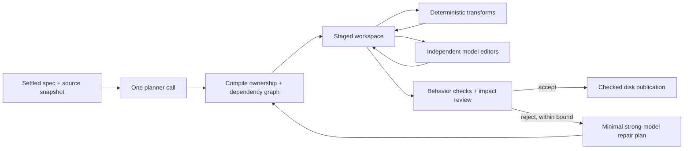

# Changeset execution research

Compile a settled feature into a plan, execute its independent edits concurrently,
and evaluate behavior across the resulting files. Experimental source lives in
`../changeset/`; the planner skill is `../../skills/spec-changeset-plan/`.

The runtime is a PoC for small UTF-8 workspaces (up to 2,000 files and 8 MiB), not a
replacement for a language server or a production transaction manager. Model requests additionally cap prepared prompt bytes plus overhead at 100,000, so the one-shot planner supports smaller source snapshots than deterministic execution. It supports
exact text and JSON transformations, file creation/deletion/rename, and bounded model
edits. It does not claim semantic merging of concurrent edits to the same symbol.
Overlapping declared resources are ordered automatically. Publication requires an
exclusive external writer: source hashes detect existing drift, but multi-file disk
writes are not crash-atomic and cannot isolate uncooperative concurrent processes.

The experiment distinguishes three sources of work: planning, applying edits, and
checking integrated behavior. Model executors receive their current declared files
and the original task contract, produce one JSON response, and have no tools or
repair conversation. Deterministic operations require no model call. Failed operations
produce explicit exceptions; failed batches leave the caller's workspace unchanged.

Observed results and their limits are in [FINDINGS.md](FINDINGS.md), with compact receipts and frozen-plan identity in [results.json](results.json).
The later [matched study](../changeset-study/FINDINGS.md) compares complete workflows
against native coding-agent tools with the same models.

## Execution boundary



The cycle is bounded at the whole-batch boundary. Each editor gets one response;
model editors do not read files through tools or retry their own changes. The staged
workspace supplies current declared content after predecessors complete. This retains
ordinary read/edit semantics while removing interactive discovery from execution.

## Running

Use Node 22.19+ and the configured Pi installation. Live calls use Pi's provider
configuration and credentials without copying credentials into fixtures or reports.
Choose exact model selectors from `pi --list-models`; no model is selected implicitly.

```sh
node scripts/changeset/cli.mjs --repo /absolute/fixture \
  --plan /absolute/plan.json --report /absolute/report.json
```

This stages and reports a dry run. Optional `--advice /absolute/jev.json` applies confident upward Jev tier advice; uncertainty retains the planner classification. Add `--publish` to write a successful batch.
`--verify /absolute/grader.mjs` executes a trusted Node behavioral check against a
temporary materialization before publication. The grader receives that directory as
argv[2]. For model operations provide `--simple-model`, `--involved-model`, and
`--budget /absolute/budget.json`; pass `--spec /absolute/spec.md` to include the original contract; the shared ledger has a USD 50 cap.

Spec-gym retains frozen workload versions, candidate hashes, generated plans, every
model receipt, errors, and external behavioral checks:

```sh
CHANGESET_BUDGET=/absolute/research/budget.json \
node scripts/spec-gym/cli.mjs run --skill spec-changeset-plan \
  --scenario invoice-rollup --model deepseek/deepseek-flash:low \
  --root /absolute/research/gym
node scripts/changeset-research/report.mjs /absolute/research/gym /absolute/research/summary.json
```

The fixture library contains training and held-out workloads. Keep held-out checks
fixed when changing the runtime. `node scripts/changeset/curate.mjs` is a curator
command that regenerates the library; it is never exposed to workers. Regenerate the
index with spec-gym's `validate --skill spec-changeset-plan --write-index` after a
curator change. Scenario files must be tracked before ready scenarios can run.

Dollar amounts are provider-catalog estimates. Subscription models may consume quota
without an incremental API charge. Unknown or interrupted calls retain their full
budget reservation. The ledger refuses further calls when the remaining allowance
cannot cover their conservative bound. Reservations are not invoices.

## Evidence limits

Passing these synthetic workloads proves the tested mechanisms and behavior. It does
not establish a production success rate or a general speedup over an agent workflow.
Compare identical frozen inputs and include planner time, executor time, all model
usage, failures and repair costs. A parallel-versus-serial comparison isolates scheduling;
a serial model-only comparison additionally measures routing. Neither alone measures
the full cost of a conventional interactive coding agent.

## Paired application benchmarks

Freeze a successful cell's plan and initial Git tree, then compare execution
strategies on fresh workspaces with the same external behavior grader:

```sh
node scripts/changeset-research/compare.mjs \
  --campaign /absolute/research/gym/RUN --cell CELL_ID \
  --root /absolute/research/comparisons --budget /absolute/research/budget.json \
  --repeat 2 --strategy parallel --strategy serial --strategy serial-model
```

`parallel` and `serial` use the same routed executors. `serial-model` applies every
operation, including mechanical transformations, sequentially with the source
planner model. `parallel-sol` uses the planner Sol model for involved edits with Mercury still applying simple edits. `parallel-deepseek-32k` raises only DeepSeek executor output allowance to 32,000 tokens. Optional `parallel-fast` disables DeepSeek editor reasoning while
retaining parallel routing; its quality must pass the same assertions. Alternate
strategy order across repetitions to reduce order effects. Run comparisons without
other inference workloads if interpreting wall time. These are application-only
measurements; the source planning cost is retained separately. They are not a
measurement of a conventional read/edit/check agent and do not include final model
review latency. All failures remain in results.


Comparison reports retain `cost_usd` as the original catalog estimate and add
`equivalent_cost_usd`: Sol tokens are priced at the observed native DeepSeek rates
(input $0.30, output $1.20, cached input $0.006 per million tokens). This is the
operator's subscription comparison assumption, not an invoice or a claim about
subscription quotas. The original conservative USD 50 ledger remains unchanged.

`runWorkflow` is the batch boundary API: behavior verification followed by impact
review, with zero to two repairs permitted. Scenarios explicitly select `repair_model` to escalate model work after a rejected batch; successful outputs remain staged. The standalone CLI applies a supplied
plan with optional behavior verification; gym uses the full planner/reviewer
workflow. Failed plans are retained as failures, including malformed JSON and token
limits. The runtime does not silently retry or repair an individual model call.


To compare recovery from an observed editor failure, pass `--allow-failed-source`.
This still requires a compilable frozen original plan and unchanged workload;
the manifest records that the source failed. It does not turn that source result
into a success. Every strategy starts from the initial tree, with no repaired files.
