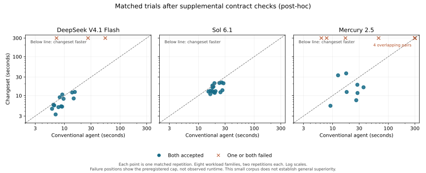

# Changesets improve the Sol workflow on this bounded corpus

The matched study supports a specific efficiency claim: with Sol 6.1 in every role,
the changeset workflow passed all 16 trials and used about 24% less end-to-end time
than the same model using native coding tools. Both approaches retained all 16 passes
under supplemental contract checks. This is evidence for this implementation and
these workloads, not a general advantage across models or production repositories.

## What was compared

Eight workload families, three models, two approaches and two repetitions produced
96 trials. Six tasks are synthetic; two reproduce historical fixes in extracted
repository modules. The conventional baseline used Pi's standard prompt and native
read, bash, edit and write tools, including native parallel tool execution and batching.
Both arms received identical tasks and source, visible tests and a common impact review.
Two historical cases included discovery; the others supplied source context up front.

Timing includes startup, discovery, planning, execution, checks, review, repair and
terminal grading. Hidden tests were inaccessible during implementation. Each trial
had a 300-second and 32-call limit; failed trials remained in the results. Code, prompts,
workloads and the SDK were frozen before the campaign.

## Results

| Model | Original checks: agent / changeset | Supplemental checks: agent / changeset | Conclusion |
|---|---:|---:|---|
| Sol 6.1 | 16/16 / 16/16 | 16/16 / 16/16 | Lower time and resource use with unchanged observed acceptance. |
| DeepSeek V4.1 Flash | 16/16 / 15/16 | 16/16 / 13/16 | Faster successful runs, but lower acceptance; no overall superiority established. |
| Mercury 2.5 | 14/16 / 10/16 | 12/16 / 8/16 | More changeset failures; the architecture did not compensate for weaker planning and formatting. |

For Sol, the task-balanced speed ratio was **1.32×**, with a task-cluster bootstrap
95% interval of **1.17–1.52×**. Mean wall time fell from **20.45 to 15.60 seconds**;
median time fell from 19.02 to 13.54 seconds. Model calls fell from **77 to 41**,
total reported tokens from **180,424 to 78,622**, and equivalent cost from
**$0.05869 to $0.03020** across the 16 trials. Equivalent cost prices Sol tokens at
DeepSeek rates as requested; it does not measure subscription charges or quota.

The principal observed mechanism was fewer model round trips and less repeated
context. Sol used only one separate editor call across all 16 changeset trials:
it usually generated exact executable edits in the plan itself. This study therefore
does **not** attribute its Sol result to cheaper editor routing or parallel model calls.
The earlier prepared-plan experiments provide separate evidence for fan-out.

## The coverage audit changed the reliability assessment

Source inspection found that the original session grader missed the explicit
requirement to preserve behavior when a file has no session header. Additional
checks for that and other contract boundaries were validated against reference
implementations and applied to all 96 frozen candidates. They found six additional
regressions: two DeepSeek changesets and four Mercury candidates across both arms.

These checks are labeled **post-hoc**. The original scores remain recorded, candidates
were not repaired, and no further model calls were used to produce new implementations.
Sol's result survived this audit. The missed cases show why tests and model review
cannot establish general correctness, even in a controlled experiment.

## Limits and next decision

This corpus is small and purposively selected. Two repetitions do not establish
production reliability. The bootstrap describes variation across these task families;
an all-pass sample does not prove equal population success rates. The historical
tasks are extracted modules, not full repository navigation or feature delivery.
Provider serving load, caching and backend deployments remain outside our control.

The strongest supported direction is to use a capable model to compile settled work
into directly executable edits, then verify integrated behavior. The study does not
show that every task benefits, that weaker models can reliably own every role, or that
mixed-model routing adds value. Larger real-repository tasks and a fresh evaluation
set are needed for those claims. The fixed matrix is complete; spending the remaining
allowance to search for a favorable subset would not strengthen this result.

See [full results](results.md), [machine-readable evidence](results.json),
[protocol](PROTOCOL.md), [development record](DEVELOPMENT.md), and
[prior art](PRIOR-ART.md).

